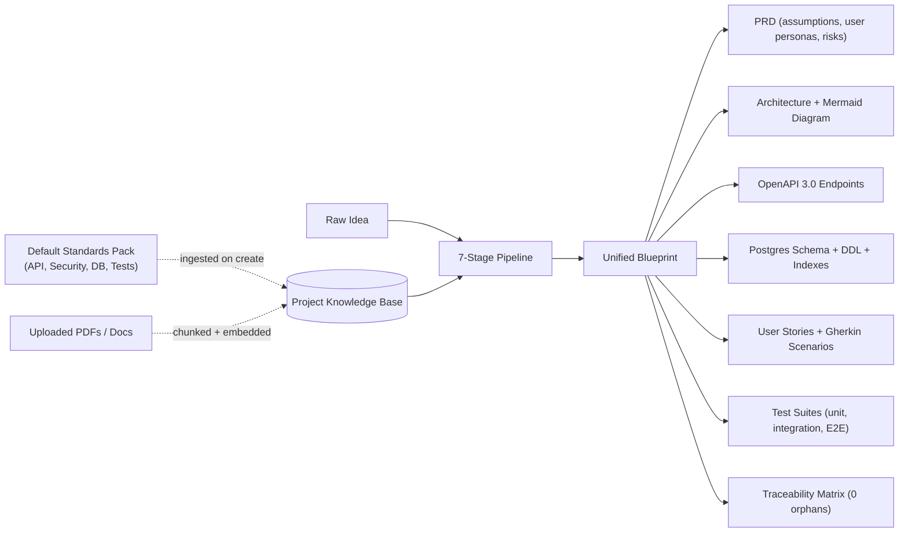

<div align="center">

# BlueprintAI

**Autonomous spec-to-architecture engine.**  
Feed in a product idea; out comes an audit-grade engineering blueprint — PRD, architecture, OpenAPI specs, SQL schema, user stories, test suites, and traceability matrix — grounded in your engineering standards, verified before you write code.

[](https://github.com/riddhibantia/BlueprintAI/actions/workflows/ci.yml)


[Live Demo](https://blueprintai-demo.fly.dev) · [Architecture](docs/ARCHITECTURE.md) · [Evaluation](docs/EVALUATION.md) · [Self-Host](docs/SPEC.md)

</div>

---

## The problem

Engineering teams don't fail at writing code. They fail at the handoff between product, architecture, and implementation:

- PRDs describe features that backend schemas can't support.
- User stories drop acceptance criteria that security policies require.
- API endpoints ship without traceability back to the original business requirement.
- "Grounded" generation usually means concatenating random markdown files into the prompt and praying the model obeys them.

BlueprintAI solves this with a **deterministic multi-stage pipeline**: each artifact is generated by a specialised agent, validated against formal consistency rules, grounded by dense + lexical retrieval over your company's actual standards, and bound to its upstream requirements with bidirectional traceability links.

---

## What BlueprintAI delivers



| Artifact | What makes it production-grade |
| :--- | :--- |
| **Grounding** | Default standards pack (API conventions, security baseline, testing policy, DB migrations) ingested on project creation + upload custom docs; hybrid retrieval (lexical + dense) with citing in the PRD |
| **Requirements engine** | Acceptance criteria in strict Gherkin (`Given/When/Then`), prioritized by risk, approved individually or in bulk |
| **Consistency gate** | Cross-artifact validation engine: detects orphan stories, endpoints referencing missing DB tables, unmapped acceptance criteria |
| **Architecture diagram** | Mermaid flowchart rendered from stored components (boundary subgraphs, kind shapes) + full Archify IR export |
| **Collaboration safety** | httpOnly `SameSite=Lax` sessions, `project_or_403` isolation, optimistic locking (409), audit logs, prod fail-closed config |
| **Export** | Full-blueprint PDF (ReportLab, markup-escaped), OpenAPI 3.0, Archify diagram IR (1:1 topology) |
| **Quality gates** | 61 pytest green, retrieval + pipeline benchmark, `tsc` + `next build` clean, browser QA pass over every route |

## Measured results (not claims)

From `evaluation/benchmark.py --full --repeats 3` — temp SQLite DB, mock LLM, clean state each run:

| Metric | Measured Value |
| :--- | :--- |
| Seeded retrieval Recall@3 | **0.907** (43-query fixture across 4 standards) |
| Adversarial recall | **0.500** |
| Mean Reciprocal Rank (MRR) | **0.884** |
| Consistency pass rate | **100%** across all generated blueprints |
| Traceability per idea | **100%, 0 orphans** |
| End-to-end latency per idea | **~0.4–0.9 s** mean, per-stage means <100 ms |

The fixture caught a real stemming bug (`writes`≠`write`). BM25 over shared stems, heading-aware chunks and IDF weighting moved overall Recall@3 0.860 → 0.907 and adversarial recall 0.25 → 0.50 with no model dependency. See `docs/EVALUATION.md`.

## AI providers: mocked by default, on purpose

BlueprintAI does **not** require an API key to evaluate or develop against. The deterministic mock generator produces semantically rich, fully consistent blueprints in milliseconds so you can test, benchmark, and run CI without spending a dollar or waiting on rate limits.

When you're ready to use live models, set two environment variables:

```bash
LLM_PROVIDER=openai             # or 'anthropic'
OPENAI_API_KEY=sk-...           # or ANTHROPIC_API_KEY=sk-ant-...
# optional: point at any OpenAI-compatible gateway (Ollama, vLLM, OpenRouter, Groq)
OPENAI_BASE_URL=https://openrouter.ai/api/v1
OPENAI_MODEL=google/gemini-2.0-flash-001
```

---

## Architecture

BlueprintAI is built as a modular monolith with strict separation between generation, persistence, and consistency verification:

```
BlueprintAI/
├── backend/
│   ├── app/
│   │   ├── agents/          # Specialised generator agents (PRD, Arch, DB, API, etc.)
│   │   ├── api/routes/      # FastAPI REST endpoints
│   │   ├── consistency/     # Cross-artifact integrity rules
│   │   ├── core/            # Config, security, DB sessions, audit logging
│   │   ├── models/          # SQLAlchemy models (User, Project, Requirement, etc.)
│   │   ├── pipeline.py      # Multi-stage orchestrator
│   │   ├── rag/             # Chunking, embeddings, hybrid retriever, standards pack
│   │   └── schemas/         # Pydantic v2 schemas
│   └── tests/               # 61 pytest suites (unit, e2e, security, rag)
├── frontend/                # Next.js 16 App Router, Tailwind v4
│   ├── app/                 # 18 routes: landing, dashboard, project stages
│   ├── components/          # Design tokens, ui components, copilot panel
│   └── lib/                 # Type-safe API client and TanStack queries
└── evaluation/              # Benchmark suite (retrieval metrics, latency, consistency)
```

Detailed architectural diagrams, data flows, and design decisions are documented in [`docs/ARCHITECTURE.md`](docs/ARCHITECTURE.md).

---

## Quickstart

### Prerequisites
- Python 3.10+
- Node.js 18+
- PostgreSQL 16 (optional; SQLite is the default for local development)

### 1. Backend setup

```powershell
# Clone the repository
git clone https://github.com/riddhibantia/BlueprintAI.git
cd BlueprintAI

# Create virtual environment
python -m venv .venv
.venv\Scripts\Activate.ps1

# Install dependencies
pip install -r backend/requirements.txt

# Start backend (auto-creates devblueprint.db and seeds default admin)
python -m uvicorn app.main:app --app-dir backend --reload --port 8000
```

Default credentials: `demo@devblueprint.io` / `Password123!`

### 2. Frontend setup

```powershell
cd frontend
npm install
npm run dev
```

Visit [`http://localhost:3000`](http://localhost:3000) to log in.

---

## Running the full pipeline

1. **Create a project** — Name it and give it an initial description. The four default engineering standards are ingested into your project's knowledge base automatically.
2. **Review requirements** — The requirements agent parses your idea into distinct functional requirements with Gherkin acceptance criteria. Approve individual requirements or click "Approve All".
3. **Run the pipeline** — Click "Run Pipeline" to generate:
   - **PRD**: Product scope, assumptions cited against your standards, user personas, risk mitigations.
   - **Architecture**: System components, protocols, boundaries, and a live Mermaid diagram.
   - **APIs**: RESTful endpoints, request/response schemas, error status codes.
   - **Database**: Tables, columns, foreign key constraints, indexes, and ready-to-run DDL.
   - **User Stories & Tasks**: Engineering tasks with estimation and priority.
   - **Test Suites**: Unit, integration, and E2E test scenarios.
   - **Traceability**: Forward and backward traceability matrix proving 100% coverage.
4. **Export** — Download the blueprint as a publication-ready PDF, OpenAPI 3.0 specification, or Archify diagram IR.

---

## Verify

```powershell
# Backend: unit + E2E + regression (61 green, isolated temp DB per run)
$env:PYTHONPATH="backend"; python -m pytest backend/tests -q

# Prove RAG grounding end to end: new project -> seeded pack -> cited PRD
$env:PYTHONPATH="backend"; python scripts/check_grounding.py

# Measured benchmark (retrieval fixture + 3-idea pipeline — see docs/EVALUATION.md)
$env:PYTHONPATH="backend"; python evaluation/benchmark.py --full --repeats 3

# Frontend: TypeScript + build
cd frontend; npm run build
```

---

## License

MIT © Riddhi Bantia
